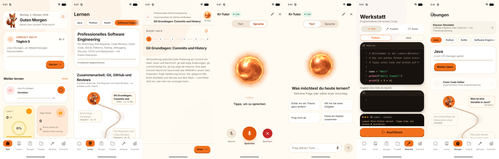
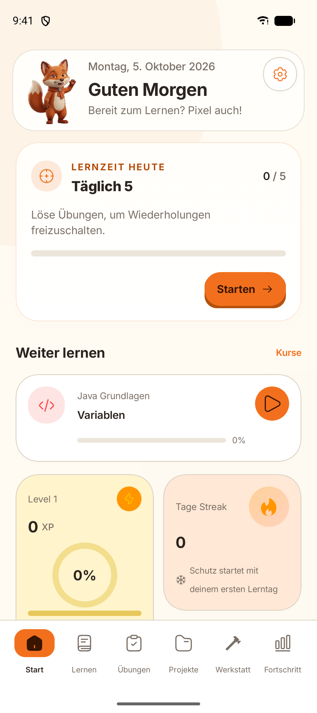
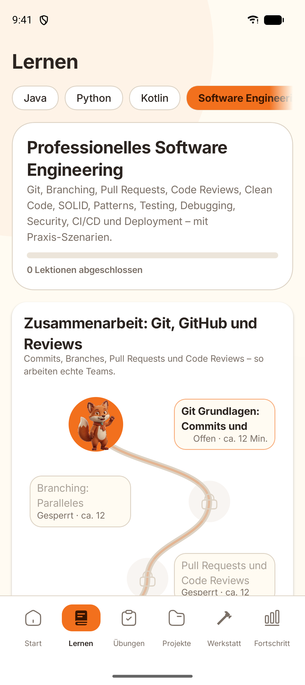
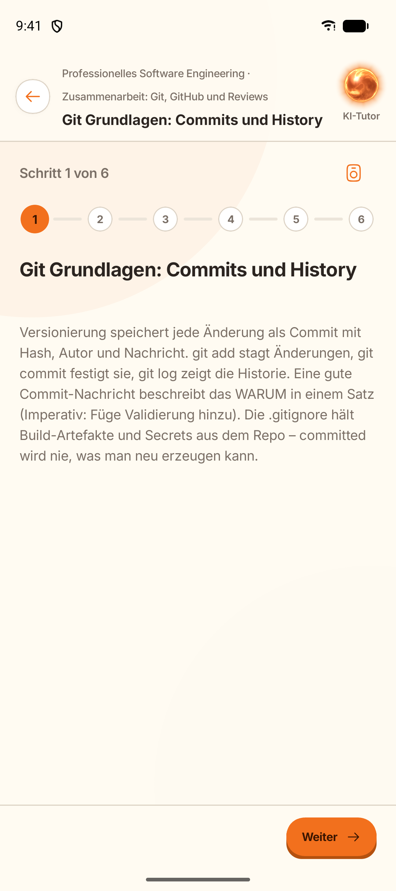
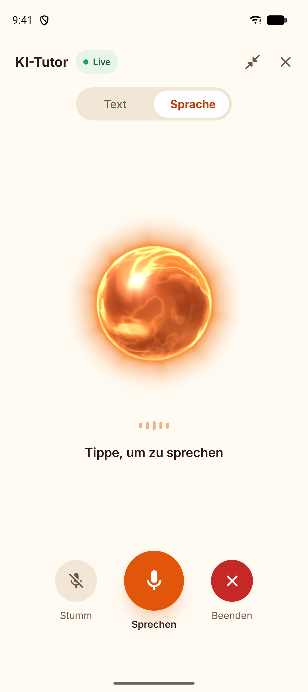
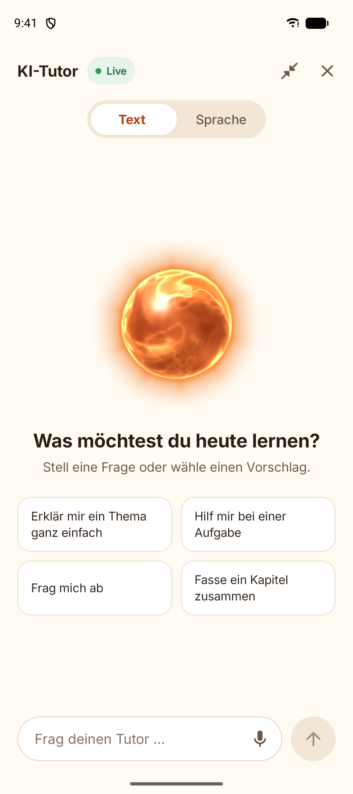
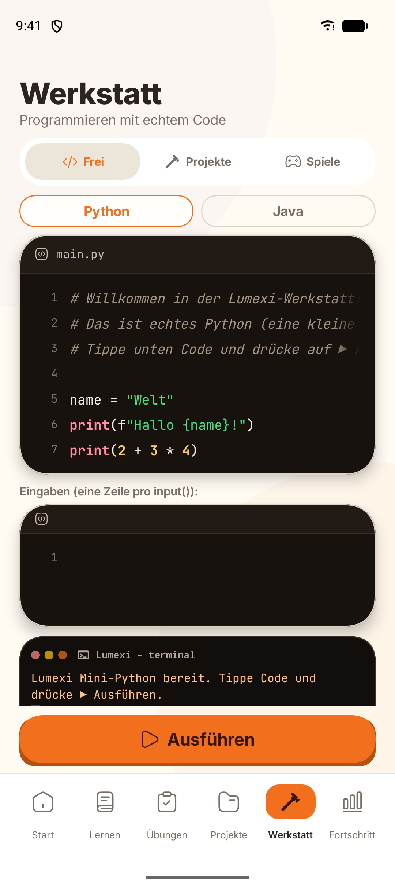
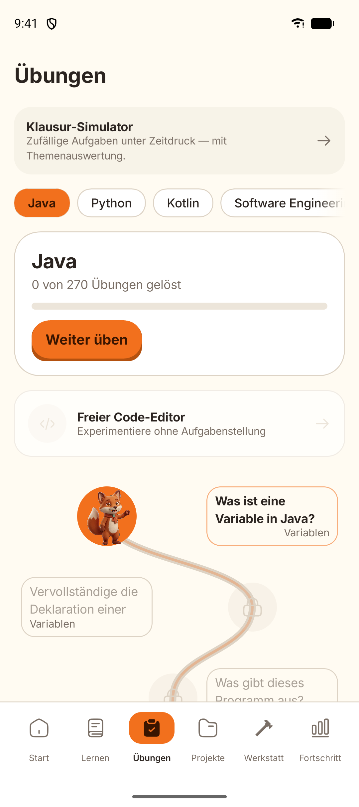

# Lumexi – Programmieren lernen in 10 Minuten am Tag

Lumexi ist eine Android-Lern-App für Programmier-Anfänger. Kurze Lektionen auf Deutsch (mit englischer Übersetzung), echte Code-Übungen und ein Lernpfad wie in einem Spiel. Das Maskottchen Pixel, ein Fuchs, begleitet durch die App.

Website: [lumexi.de](https://lumexi.de) · Datenschutz: [lumexi-legal](https://github.com/heatwaves0815/lumexi-legal)

> Dieses Repository ist ein Schaufenster. Der Quellcode der App ist privat.

## Funktionen

- **11 Sprachpfade**: Python, Java, Kotlin, C, C++, C#, JavaScript, TypeScript, SQL und mehr – von den Grundlagen bis zu Profi-Kapiteln.
- **Interaktive Übungen mit Sofort-Feedback**: Multiple Choice, Code-Lücken, Fehlersuche, Ausgabe vorhersagen.
- **Werkstatt**: Code-Editor mit Syntax-Highlighting, Autosave und Ausgabe-Panel. Eigene Mini-Interpreter für Java und Python sowie eine SQL-Werkstatt auf einer isolierten In-Memory-SQLite.
- **Täglich 5**: Wiederholungssystem (Spaced Repetition), damit Gelerntes bleibt.
- **KI-Tutor „Pixel“**: erklärt Fehler und beantwortet Fragen zur Lektion, im Text- oder Sprachmodus.
- **Motivation**: XP, Level, Tages-Streak mit Streak-Freeze, Achievements, Quests, Wochen-Challenge.
- **Klausur-Simulator** mit Timer, Zufallsfragen und Auswertung.
- **Lernprofile** für mehrere Personen an einem Gerät, Backup und Wiederherstellung, Vorlesen auf Deutsch und Englisch.
- **Offline nutzbar**: Lektionen, Übungen und Fortschritt liegen lokal auf dem Gerät. Nur der KI-Tutor braucht Internet.

## Screenshots

| Start | Lernpfad | Lektion |
|---|---|---|
|  |  |  |

| KI-Tutor (Sprache) | KI-Tutor (Text) | Werkstatt | Übungen |
|---|---|---|---|
|  |  |  |  |

## Technik

**Android-App**
- Kotlin, Jetpack Compose mit Material 3, Navigation Compose
- Room mit expliziten Migrationen, DataStore für Einstellungen
- Gamification-Engine (XP, Level, Streaks), Spaced-Repetition-Planer
- Eigene Interpreter für eine Teilmenge von Java und Python
- Sprachausgabe und Spracheingabe für den Tutor
- Android 8.0 oder neuer (minSdk 26, targetSdk 36)

**Backend**
- PHP 8.2 und MySQL
- Signierte Anfragen und tokenbasierte Anmeldung, Tageskontingente und Rate-Limiting
- Server-Proxy für den KI-Tutor, damit kein API-Schlüssel in der App steckt

**Qualität**
- Über 350 JVM-Unit-Tests
- Continuous Integration mit GitHub Actions (Tests und Builds)

## Wie die App entstanden ist

Lumexi ist seit August 2026 in Entwicklung, aktueller Stand ist Version 1.9.33.

Den Großteil des Codes hat eine KI geschrieben, unter meiner Führung. Mein Anteil ist das Produkt selbst: Idee, Anforderungen, Architektur-Grenzen, Sicherheitsregeln und die Abnahme jeder Änderung. Jede Arbeitsrunde endete mit einem Bericht, der klar trennt, was getestet ist und was nicht. KI-Code wurde nie ungeprüft übernommen.

## Rechte

© 2026 Tom Glante. Alle Rechte vorbehalten. Name, Logo, Maskottchen und Screenshots dürfen nicht ohne Erlaubnis verwendet werden.
